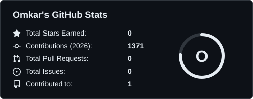
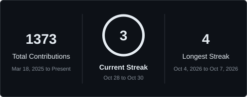
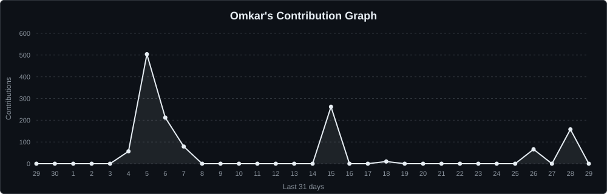

  

## 👨‍💻 About me

Hello there! I'm **Omkar Shinde**, an **aspiring software developer** and Computer Engineering student in Pune.
I like building practical software with applied AI: LLM pipelines, small tools that explain themselves,
and web apps people can actually use.

🏛️ **Computer Engineering** at Dr. D. Y. Patil Institute of Technology, Pimpri (2024 to 2028) 
💼 **Software Engineer Intern** at Sarth AI, on an LLM pipeline for an AI tutor 
🏆 **2nd Runner Up**, DEVCLASH 3.0 national hackathon (2026) 
🛠️ **Team Lead** for NetHeal at the Infosys ENG NEXT 2026 Hackathon 
🤝 **Non Tech Co Lead**, Google Developer Groups DIT (2025)

## 🚀 Featured projects

<table>
  <tr>
    <td width="33%" valign="top">
      <b><a href="https://github.com/Omkarshinde19/Netheal">NetHeal</a></b> 
      Python · FastAPI · LLM  
      Finds, explains and fixes faults in a simulated campus network, testing every fix on a copy of the network first.
      <a href="https://netheal-lilac.vercel.app">Try it live</a>.
    </td>
    <td width="33%" valign="top">
      <b><a href="https://github.com/Omkarshinde19/sleight">Sleight</a></b> 
      MediaPipe · Three.js · Next.js  
      Your hand, tracked by the webcam, controls robot hands in a basketball arcade and a surgery game.
      <a href="https://sleight-eta.vercel.app">Try it live</a>.
    </td>
    <td width="33%" valign="top">
      <b>First To Final Logistics</b> 
      Next.js · Zoho CRM  
      Freelance website for a US logistics company, with a warehouse cost calculator that sends leads into the client's CRM.
    </td>
  </tr>
</table>

## 🧰 Technologies

 

## 📈 Statistics

Cards and snake are regenerated daily by GitHub Actions in this repo.

